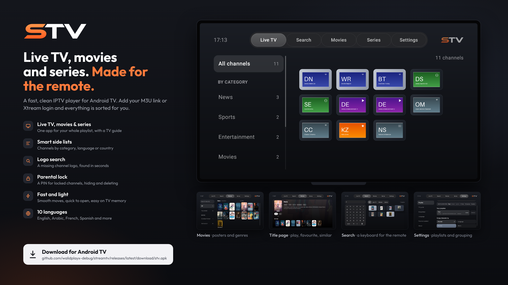

# STV



A personal IPTV player for Android TV. It comes with no channels, playlists or other content:
you add your own M3U/M3U8 link or Xtream login, and an XMLTV guide if you have one.

## Features

- **Live TV**: categories, favourites, search, channel logos (with a public logo index for
  channels that have none), now/next from an XMLTV guide
- **Movies and Series**: side menu with search, watch history, favourites and genres; a
  title page; a player with seeking, resume and subtitles
- **Channel card** (hold OK): favourite, rename, hide, lock
- **Parental PIN** for locked channels, hidden channels and removing playlists
- **10 languages**, with a right-to-left layout for Arabic
- **Updates inside the app**, with a red mark on Settings when a new version is out

## Install

Download [stv.apk](https://github.com/walidplayx-debug/streamtv/releases/latest/download/stv.apk)
and open it on the TV. If Android asks, allow installs from the app you opened it with.
Runs on Android 6.0 and newer.

## Build

Needs JDK 17 and Android SDK platform 34:

```bash
./gradlew lint testDebugUnitTest assembleRelease
```

## Releases and signing

Every push to `main` is built, linted and tested by GitHub Actions, then published as the
`latest` release (`stv.apk`). The installed app updates from that release.

APKs are signed only in CI, with a private keystore held in the repository secrets
(`KEYSTORE_BASE64`, `KEYSTORE_PASSWORD`, `KEY_ALIAS`, `KEY_PASSWORD`). No key is kept in the
code, and the build stops if the secrets are missing, so every APK carries the same signature
and installs over the previous one.

## Project layout

```
app/src/main/java/com/streamtv/
  data/   playlists (M3U, Xtream), XMLTV guide, logo index, local cache and settings
  ui/     screens, players, channel card, translations, updates
```

## Troubleshooting

- **No channels**: open the playlist link in a browser and check that it returns M3U text.
- **A channel does not play**: some providers need tokens or headers the link does not carry.
- **Update refused**: the installed copy was signed with another key; uninstall it once,
  then install `stv.apk` again.
